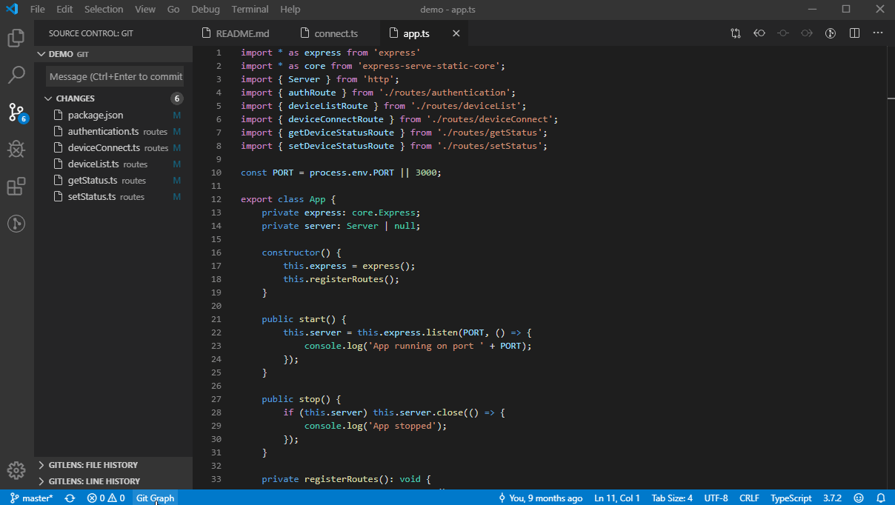

# Git Map

View a graph of your repository's Git history, and easily perform Git actions from the graph. Configurable to look the way you want!

> This is a fork of Git Graph by Michael Hutchison, continuing from its 1.30.0 release: it's adapted to recent versions of Visual Studio Code, fixes a number of reported issues, and adds new features such as a Simplified Chinese interface (see the [Release Notes](CHANGELOG.md) and the [issue triage](docs/upstream-issue-triage.md)). Its extension identifier is `aimdev.git-map`, and its commands & settings are named `git-map.*`, so it can be installed alongside the original Git Graph extension (`mhutchie.git-graph`). The projects it's based on are listed in the [Acknowledgements](#acknowledgements).

**Git Map and the Source Control Graph of Visual Studio Code:** Visual Studio Code has a built-in Source Control Graph (in the Source Control View), which shows the history of the current branch (and the branches you choose) alongside your changes: it's ideal for seeing your incoming & outgoing commits at a glance. Git Map is a full view in the editor area for working with the whole history of a repository: all of its branches, remote branches, tags, stashes & worktrees on one graph, the actions of Git from the context menus of the graph (with an undo of the last one), the details & comparisons of commits (with code reviews), the history of files & lines, the blame of the current line, and interactive rebasing in an editor. It stays fast with tens of thousands of commits. Both can be used side by side.

## Features

* Git Map View:
    * A minimap of the activity of the loaded commits, markers alongside the scrollbar (HEAD, branches, tags & find matches), and highlighting of the branch of the commit under the mouse.
    * Find commits by text, or with the search operators `author:` (`@:`), `message:` (`=:`), `commit:` (`#:`), `file:` (`?:`), `change:` (`~:`), `after:` (`>:`) and `before:` (`<:`), and highlight the matching commits or only show them.
    * Display:
        * Local & Remote Branches
        * Local Refs: Heads, Tags & Remotes
        * Uncommitted Changes
    * Perform Git Actions (available by right clicking on a commit / branch / tag):
        * Create, Checkout, Delete, Fetch, Merge, Pull, Push, Rebase, Rename & Reset Branches
        * Add, Delete & Push Tags
        * Checkout, Cherry Pick, Drop, Merge & Revert Commits
        * Clean, Reset & Stash Uncommitted Changes
        * Apply, Create Branch From, Drop & Pop Stashes
        * View annotated tag details (name, email, date and message)
        * Copy commit hashes, and branch, stash & tag names to the clipboard
        * Create, Open, Remove & Prune Worktrees
    * Select several commits (Shift + click selects a range, Ctrl/Cmd + Shift + click adds or removes a commit) to cherry pick them together, or copy their hashes. Hovering over a commit shows buttons of its most common actions at the end of its row.
    * Undo the last action run by Git Map in a repository (e.g. a merge, rebase, reset, cherry pick, checkout, or creating / deleting a branch or tag) with the Undo button, unless the repository has changed since. Uncommitted changes are never discarded.
    * Rebase interactively in the Rebase Editor: reorder the commits by dragging them, and pick, reword, squash, fixup or drop each one. While a rebase, merge, cherry pick or revert is in progress, a bar explains it, with buttons to continue, skip or abort it.
    * The Worktrees & Stashes buttons list the worktrees & stashes of the repository. Branches checked out in other worktrees are marked.
    * View commit details and file changes by clicking on a commit. On the Commit Details View you can:
        * View the Visual Studio Code Diff of any file change by clicking on it.
        * Open the current version of any file that was affected in the commit.
        * Copy the path of any file that was affected in the commit to the clipboard.
        * Click on any HTTP/HTTPS url in the commit body to open it in your default web browser.
    * Compare any two commits by clicking on a commit, and then CTRL/CMD clicking on another commit. On the Commit Comparison View you can:
        * View the Visual Studio Code Diff of any file change between the selected commits by clicking on it.
        * Open the current version of any file that was affected between the selected commits.
        * Copy the path of any file that was affected between the selected commits to the clipboard.
    * Code Review - Keep track of which files you have reviewed in the Commit Details & Comparison Views.
        * Code Review's can be performed on any commit, or between any two commits (not on Uncommitted Changes).
        * When a Code Review is started, all files needing to be reviewed are bolded. When you view the diff / open a file, it will then be un-bolded.
        * Code Reviews persist across Visual Studio Code sessions. They are automatically closed after 90 days of inactivity.
    * View uncommitted changes, and compare the uncommitted changes with any commit.
    * Hover over any commit vertex on the graph to see a tooltip indicating:
        * Whether the commit is included in the HEAD.
        * Which branches, tags and stashes include the commit. 
    * Filter the branches shown in Git Map using the 'Branches' dropdown menu. The options for filtering the branches are:
        * Show All branches
        * Select one or more branches to be viewed
        * Select from a user predefined array of custom glob patterns (by setting `git-map.customBranchGlobPatterns`)
    * Fetch from Remote(s) _(available on the top control bar)_
    * Find Widget allows you to quickly find one or more commits containing a specific phrase (in the commit message / date / author / hash, branch or tag names).
    * Repository Settings Widget:
        * Allows you to view, add, edit, delete, fetch & prune remotes of the repository.
        * Configure "Issue Linking" - Converts issue numbers in commit messages into hyperlinks, that open the issue in your issue tracking system.
        * Configure "Pull Request Creation" - Automates the opening and pre-filling of a Pull Request form, directly from a branches context menu.
            * Support for the publicly hosted Bitbucket, GitHub and GitLab Pull Request providers is built-in.
            * Custom Pull Request providers can be configured using the Extension Setting `git-map.customPullRequestProviders` (e.g. for use with privately hosted Pull Request providers). Information on how to configure custom providers is available [here](https://github.com/aimuch/vscode-git-map/blob/main/docs/extension-settings.md#custom-pull-request-providers).
        * Export your Git Map Repository Configuration to a file that can be committed in the repository. It allows others working in the same repository to automatically use the same Git Map configuration.
    * Keyboard Shortcuts (available in the Git Map View):
        * `CTRL/CMD + F`: Open the Find Widget.
        * `CTRL/CMD + H`: Scrolls the Git Map View to be centered on the commit referenced by HEAD.
        * `CTRL/CMD + R`: Refresh the Git Map View.
        * `CTRL/CMD + S`: Scrolls the Git Map View to the first (or next) stash in the loaded commits.
        * `CTRL/CMD + SHIFT + S`: Scrolls the Git Map View to the last (or previous) stash in the loaded commits.
        * When the Commit Details View is open on a commit:
            * `Up` / `Down`: The Commit Details View will be opened on the commit directly above or below it on the Git Map View.
            * `CTRL/CMD + Up` / `CTRL/CMD + Down`: The Commit Details View will be opened on its child or parent commit on the same branch.
                * If the Shift Key is also pressed (i.e. `CTRL/CMD + SHIFT + Up` / `CTRL/CMD + SHIFT + Down`), when branches or merges are encountered the alternative branch is followed.
        * `Enter`: If a dialog is open, pressing enter submits the dialog, taking the primary (left) action.
        * `Escape`: Closes the active dialog, context menu or the Commit Details View.
    * Resize the width of each column, and show/hide the Date, Author & Commit columns.
    * Common Emoji Shortcodes are automatically replaced with the corresponding emoji in commit messages (including all [gitmoji](https://gitmoji.carloscuesta.me/)). Custom Emoji Shortcode mappings can be defined in `git-map.customEmojiShortcodeMappings`.
* Line History (right-click on lines > Git Map > View Line History): how the selected lines changed, without leaving the editor, in a drawer on the right or an inline window below the lines (`git-map.lineHistory.location`). A timeline of the uncommitted changes & each commit that changed the lines (following them as they move, and the file through renames), with the author, their avatar and the date, and the selected change's diff of the lines, with actions to open the changes, open the file at the commit, show the lines before the change, view the commit in Git Map, and copy a link to the lines on the remote. The drawer can follow the cursor (`git-map.lineHistory.followCursor`).
* File History: "View File History in Git Map" (in the context menus of files in the Explorer & editor tabs) shows only the commits that change a file (following it through renames), and how each commit changes it. "View Line History in Git Map" does the same for lines.
* Current Line Blame: the line the cursor is on shows who last changed it, and when & why, at its end. Hovering over it shows how the commit changed the line, with links to view the history of the line, open the changes, view the commit in Git Map, and copy a link to the line on the remote.
* File Blame: "Toggle File Blame" annotates each block of lines with the date & author of the commit that last changed it, coloured by how recently it was made (a heatmap from blue, the oldest, to orange, the newest).
* Revisions: "Show Previous Revision" & "Show Next Revision" (arrow buttons on the diffs & files opened by Git Map) step through the commits that changed a file.
* Remote Links: "Copy Remote Link to Lines" & "Open Lines on Remote" link to the selected lines on the remote's web page (GitHub, GitLab, Bitbucket, Gitea / Forgejo / Codeberg & Azure DevOps), at a commit.
* Git CodeLens (`git-map.codeLens.enabled`, off by default): who changed each function, method & class most recently, and how many authors changed it.
* The editor's context menu has a "Git Map" submenu with these actions. No other extension is required: everything uses Visual Studio Code's API and Git.
* A broad range of configurable settings (e.g. graph style, branch colours, and more...). See the 'Extension Settings' section below for more information.
* "Git Map" launch button in the Status Bar
* "Git Map: View Git Map" launch command in the Command Palette

## Extension Settings

Every setting is described in the Visual Studio Code Settings Editor (search for `@ext:aimdev.git-map`), and the settings that need more explanation are documented in [Extension Settings](https://github.com/aimuch/vscode-git-map/blob/main/docs/extension-settings.md).

A summary of the Git Map extension settings are:
* **Blame**:
    * **Current Line**: Show who last changed the line the cursor is on, and when & why (the author, date & subject of the commit), at the end of the line in the editor (default: enabled).
* **Commit Details View**:
    * **Auto Center**: Automatically center the Commit Details View when it is opened.
    * **File View**:
        * **File Tree**:
            * **Compact Folders**: Render the File Tree in the Commit Details View in a compacted form, such that folders with a single child folder are compressed into a single combined folder element.
        * **Type**: Sets the default type of File View used in the Commit Details View.
    * **Location**: Specifies where the Commit Details View is rendered in the Git Map View: Inline (below the commit), Docked to Bottom, or Docked to Right (default).
* **Context Menu Actions Visibility**: Customise which context menu actions are visible. For more information, see the documentation [here](https://github.com/aimuch/vscode-git-map/blob/main/docs/extension-settings.md#context-menu-actions-visibility).
* **Custom Branch Glob Patterns**: An array of Custom Glob Patterns to be shown in the "Branches" dropdown. Example: `[{"name":"Feature Requests", "glob":"heads/feature/*"}]`
* **Custom Emoji Shortcode Mappings**: An array of custom Emoji Shortcode mappings. Example: `[{"shortcode": ":sparkles:", "emoji":"✨"}]`
* **Custom Pull Request Providers**: An array of custom Pull Request providers that can be used in the "Pull Request Creation" Integration. For information on how to configure this setting, see the documentation [here](https://github.com/aimuch/vscode-git-map/blob/main/docs/extension-settings.md#custom-pull-request-providers).
* **Date**:
    * **Format**: Specifies the date format to be used in the "Date" column on the Git Map View.
    * **Type**: Specifies the date type to be displayed in the "Date" column on the Git Map View, either the author or commit date.
* **Default Column Visibility**: An object specifying the default visibility of the Date, Author & Commit columns. Example: `{"Date": true, "Author": true, "Commit": true}`
* **Dialog > \***: Set the default options on the following dialogs: Add Tag, Apply Stash, Cherry Pick, Create Branch, Delete Branch, Fetch into Local Branch, Fetch Remote, Merge, Pop Stash, Pull Branch, Rebase, Reset, and Stash Uncommitted Changes
* **Enhanced Accessibility**: Visual file change A|M|D|R|U indicators in the Commit Details View for users with colour blindness. In the future, this setting will enable any additional accessibility related features of Git Map that aren't enabled by default.
* **File Encoding**: The character set encoding used when retrieving a specific version of repository files (e.g. in the Diff View). A list of all supported encodings can be found [here](https://github.com/ashtuchkin/iconv-lite/wiki/Supported-Encodings).
* **Graph**:
    * **Minimap**: Show a minimap of the activity of the loaded commits at the top of the Git Map View (default: enabled).
    * **Colour Preset**: Specifies the colour preset used on the graph: Default (the colours of the "Colours" setting), Pastel, Vivid, High Contrast, Colour Blind Safe or Tokyo Subway. It can also be selected with the "Git Map: Select Graph Colour Preset..." command.
    * **Colours**: Specifies the colours used on the graph.
    * **Density**: Specifies the height of the rows of the commits: Comfortable (32 pixel rows, default) or Compact (24 pixel rows).
    * **Freeze Column Headers** & **Freeze Footer**: Keep the column headers & the footer visible while scrolling through the commits (default: enabled).
    * **Node Style**: Specifies how commits are drawn on the graph: as dots (default), or as the avatars of their authors.
    * **Style**: Specifies the style of the graph.
    * **Uncommitted Changes**: Specifies how the Uncommitted Changes are displayed on the graph.
* **CodeLens**:
    * **Enabled**: Show who changed functions, methods & classes most recently (and when), and how many authors changed them, above them in the editor (default: disabled).
* **Integrated Terminal Shell**: Specifies the path and filename of the Shell executable to be used by the Visual Studio Code Integrated Terminal, when it is opened by Git Map.
* **Keyboard Shortcut > \***: Configures the keybindings used for all keyboard shortcuts in the Git Map View.
* **Language**: Specifies the language that Git Map is displayed in: Auto (the display language of Visual Studio Code, default), English or Simplified Chinese. The descriptions of Git Map's commands and settings always follow the display language of Visual Studio Code.
* **Line History**:
    * **Follow Cursor**: The Line History drawer shows the history of the line the cursor is on, following the cursor (default: disabled).
    * **Location**: Where the history of lines is shown: in a drawer on the right (default), or in an inline window below the lines.
* **Markdown**: Parse and render a frequently used subset of inline Markdown formatting rules in commit messages and tag details (bold, italics, bold & italics, and inline code blocks).
* **Max Depth Of Repo Search**: Specifies the maximum depth of subfolders to search when discovering repositories in the workspace.
* **Open New Tab Editor Group**: Specifies the Editor Group where Git Map should open new tabs, when performing the following actions from the Git Map View: Viewing the Visual Studio Code Diff View, Opening a File, Viewing a File at a Specific Revision.
* **Open to the Repo of the Active Text Editor Document**: Open the Git Map View to the repository containing the active Text Editor document.
* **Reference Labels**:
    * **Alignment**: Specifies how branch and tag reference labels are aligned for each commit.
    * **Combine Local and Remote Branch Labels**: Combine local and remote branch labels if they refer to the same branch, and are on the same commit.
* **Repository**:
    * **Commits**:
        * **Fetch Avatars**: Fetch avatars of commit authors and committers.
        * **Initial Load**: Specifies the number of commits to initially load.
        * **Load More**: Specifies the number of additional commits to load when the "Load More Commits" button is pressed, or more commits are automatically loaded.
        * **Load More Automatically**: When the view has been scrolled to the bottom, automatically load more commits if they exist (instead of having to press the "Load More Commits" button).
        * **Mute**:
            * **Commits that are not ancestors of HEAD**: Display commits that aren't ancestors of the checked-out branch / commit with a muted text color.
            * **Merge Commits**: Display merge commits with a muted text color.
        * **Order**: Specifies the order of commits on the Git Map View. See [git log](https://git-scm.com/docs/git-log#_commit_ordering) for more information on each order option.
        * **Show Signature Status**: Show the commit's signature status to the right of the Committer in the Commit Details View (only for signed commits). Hovering over the signature icon displays a tooltip with the signature details.
    * **Fetch and Prune**: Before fetching from remote(s) using the Fetch button on the Git Map View Control Bar, remove any remote-tracking references that no longer exist on the remote(s).
    * **Fetch And Prune Tags**: Before fetching from remote(s) using the Fetch button on the Git Map View Control Bar, remove any local tags that no longer exist on the remote(s).
    * **Include Commits Mentioned By Reflogs**: Include commits only mentioned by reflogs in the Git Map View (only applies when showing all branches).
    * **On Load**:
        * **Scroll To Head**: Automatically scroll the Git Map View to be centered on the commit referenced by HEAD.
        * **Show Checked Out Branch**: Show the checked out branch when a repository is loaded in the Git Map View.
        * **Show Specific Branches**: Show specific branches when a repository is loaded in the Git Map View.
    * **Only Follow First Parent**: Only follow the first parent of commits when discovering the commits to load in the Git Map View. See [--first-parent](https://git-scm.com/docs/git-log#Documentation/git-log.txt---first-parent) to find out more about this setting.
    * **Show Commits Only Referenced By Tags**: Show Commits that are only referenced by tags in Git Map.
    * **Show Remote Branches**: Show Remote Branches in Git Map by default.
    * **Show Remote Heads**: Show Remote HEAD Symbolic References in Git Map.
    * **Show Stashes**: Show Stashes in Git Map by default.
    * **Show Tags**: Show Tags in Git Map by default.
    * **Show Uncommitted Changes**: Show uncommitted changes. If you work on large repositories, disabling this setting can reduce the load time of the Git Map View.
    * **Show Untracked Files**: Show untracked files when viewing the uncommitted changes. If you work on large repositories, disabling this setting can reduce the load time of the Git Map View.
    * **Sign**:
        * **Commits**: Enables commit signing with GPG or X.509.
        * **Tags**: Enables tag signing with GPG or X.509.
    * **Use Mailmap**: Respect [.mailmap](https://git-scm.com/docs/git-check-mailmap#_mapping_authors) files when displaying author & committer names and email addresses.
* **Repository Dropdown Order**: Specifies the order that repositories are sorted in the repository dropdown on the Git Map View (only visible when more than one repository exists in the current Visual Studio Code Workspace).
* **Retain Context When Hidden**: Specifies if the Git Map view Visual Studio Code context is kept when the panel is no longer visible (e.g. moved to background tab). Enabling this setting will make Git Map load significantly faster when switching back to the Git Map tab, however has a higher memory overhead.
* **Show Status Bar Item**: Show a Status Bar Item that opens the Git Map View when clicked.
* **Status Bar Item Display**: Specifies what the Status Bar Item displays: the Git Map icon and text (default), only the icon, or only the text.
* **Source Code Provider Integration Location**: Specifies where the "View Git Map" action appears on the title of SCM Providers.
* **Tab Icon Colour Theme**: Specifies the colour theme of the icon displayed on the Git Map tab.

This extension consumes the following settings:

* `git.path`: Specifies the path and filename of a portable Git installation.

## Extension Commands

This extension contributes the following commands:

* `git-map.view`: Git Map: View Git Map
* `git-map.addGitRepository`: Git Map: Add Git Repository... _(used to add sub-repos to Git Map)_
* `git-map.clearAvatarCache`: Git Map: Clear Avatar Cache
* `git-map.endAllWorkspaceCodeReviews`: Git Map: End All Code Reviews in Workspace
* `git-map.endSpecificWorkspaceCodeReview`: Git Map: End a specific Code Review in Workspace... _(used to end a specific Code Review without having to first open it in the Git Map View)_
* `git-map.fetch`: Git Map: Fetch from Remote(s) _(used to open the Git Map View and immediately run "Fetch from Remote(s)")_
* `git-map.removeGitRepository`: Git Map: Remove Git Repository... _(used to remove repositories from Git Map)_
* `git-map.resumeWorkspaceCodeReview`: Git Map: Resume a specific Code Review in Workspace... _(used to open the Git Map View to a Code Review that is already in progress)_
* `git-map.selectGraphColourPreset`: Git Map: Select Graph Colour Preset...
* `git-map.toggleFileBlame`: Git Map: Toggle File Blame
* `git-map.toggleLineBlame`: Git Map: Toggle Current Line Blame
* `git-map.version`: Git Map: Get Version Information
* `git-map.viewFileHistory`: Git Map: View File History in Git Map
* `git-map.viewLineHistory`: Git Map: View Line History _(in the drawer or an inline window)_
* `git-map.viewLineHistoryInGitMap`: Git Map: View Line History in Git Map
* `git-map.openPreviousRevision` / `git-map.openNextRevision`: Git Map: Show Previous / Next Revision
* `git-map.copyRemoteLinkToLines` / `git-map.openLinesOnRemote`: Git Map: Copy Remote Link to Lines / Open Lines on Remote

## Release Notes

Detailed Release Notes are available [here](CHANGELOG.md).

## Installation

This fork isn't published on the Visual Studio Marketplace. Get the VSIX (offline installation package) in one of the following ways:
* Download `git-map-<version>.vsix` from the [GitHub Releases](https://github.com/aimuch/vscode-git-map/releases) of the repository: the `dev` pre-release is the latest build of the main branch (updated on every push), and each tagged version has its own release. Every [Build & Test](https://github.com/aimuch/vscode-git-map/actions/workflows/build-and-test.yml) workflow run also has the VSIX as its `git-graph-vsix` artifact.
* Build it: run `npm install`, then `npm run package` to create `git-map-<version>.vsix`.

Install the VSIX, either with `code --install-extension git-map-<version>.vsix --force`, or from the Extensions View in Visual Studio Code (`...` > Install from VSIX...).

The original Git Graph extension (`mhutchie.git-graph`) can stay installed, as Git Map's commands & settings are named `git-map.*`. When Git Map starts, it copies the settings named `git-graph.*` in `settings.json` (used by Git Graph, and by Git Map before version 2.1.0) to their new names, once for the user settings and once for each workspace (a setting that's already set under its new name is kept). It then offers to remove the `git-graph.*` settings, unless Git Graph is installed (which still uses them). Keybindings of the `git-graph.*` commands in `keybindings.json` need to be changed to the `git-map.*` commands by hand. Git Graph's per-repository state (e.g. column widths, hidden remotes, Issue Linking & Pull Request configuration) is stored per extension, and starts empty. Use "Export Repository Configuration" in the original extension's Repository Settings to keep a repository's configuration.

## Acknowledgements

This extension is based on, includes, or takes ideas from the following projects. Thank you to their authors and contributors for their excellent work!

* [Git Graph](https://github.com/mhutchie/vscode-git-graph) by Michael Hutchison ([@mhutchie](https://github.com/mhutchie)): The original extension. This fork is based on its 1.30.0 release, and is subject to the terms of its [LICENSE](LICENSE).
* [GitLens](https://github.com/gitkraken/vscode-gitlens) by GitKraken (created by Eric Amodio): Ideas for features & the design of the user interface. No GitLens code is included.
* [Visual Studio Code](https://github.com/microsoft/vscode) by Microsoft: Its Git extension is the base of Git Map's integrated Askpass ([License](licenses/LICENSE_MICROSOFT)).
* [GitHub Octicons](https://github.com/primer/octicons): Icons ([License](licenses/LICENSE_OCTICONS)).
* [Icons8](https://icons8.com/icon/pack/free-icons/ios11): Icons ([License](https://icons8.com/license)).
* [iconv-lite](https://github.com/pillarjs/iconv-lite): Decoding of files in character set encodings other than UTF-8 ([License](https://github.com/pillarjs/iconv-lite/blob/master/LICENSE)).
